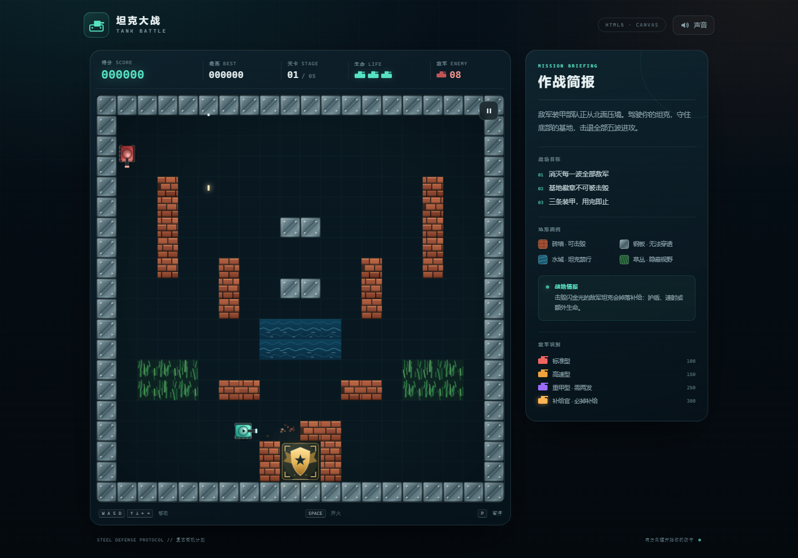

<div align="center">

# 坦克大战 · TANK BATTLE

**用原生 HTML5 Canvas 打造的街机坦克游戏。零依赖，打开即玩。**

守住南侧基地，击退五波装甲部队。

[在线试玩](https://yyyy-gitch-ship-git.github.io/tank-battle/) · [功能介绍](#功能) · [操作说明](#操作) · [本地运行](#本地运行)



</div>

## 关于

这是一个完整的单人坦克防守游戏，灵感来自 1985 年的经典街机《Battle City》。全部画面由 Canvas 2D 实时绘制，音效由 Web Audio API 合成，没有任何图片素材、第三方库或构建步骤。

五关战役、三种地图布局、四类敌军、可破坏地形、随机补给、基地攻防、键鼠与触屏操作——打开网页即可开始。

## 功能

- **五关战役**：敌军数量、装甲强度与推进速度逐关提升，地图在三种布局间轮换。
- **四类敌军**：标准型、高速型、重甲型（需两发击毁），以及闪金光的「补给官」。
- **可破坏战场**：砖墙可被炮火击穿，钢板无法穿透，水域阻挡坦克，草丛遮住车体。
- **战场补给**：击毁补给官会掉落护盾、速射或额外生命。
- **基地防守**：基地徽章被击毁即任务失败；三条装甲耗尽同样结束。
- **完整流程**：开始、暂停、关卡结算、胜利、失败与重开，最高分保存在本地。
- **双端操作**：桌面端使用键盘，移动端自动显示方向键与开火按钮。
- **合成音效**：射击、爆炸、补给与关卡提示音均由 Web Audio 实时合成，可随时静音。
- **无外部依赖**：纯 HTML / CSS / JavaScript，无字体、图片或 CDN 请求。

## 操作

| 操作 | 键盘 | 触屏 |
| --- | --- | --- |
| 移动 | `W` `A` `S` `D` / 方向键 | 左侧方向键 |
| 开火 | `Space` / `J` | 右侧 `FIRE` 按钮 |
| 暂停 / 继续 | `P` / `Esc` | 画面右上角暂停按钮 |
| 静音 | `M` | 顶部「声音」按钮 |
| 重开（暂停或失败时） | `R` | 结算界面按钮 |

## 本地运行

这是一个纯静态页面，无需安装依赖。

```bash
git clone https://github.com/yyyy-gitch-ship-git/tank-battle.git
cd tank-battle
python -m http.server 8000
```

打开 <http://localhost:8000> 即可游玩。也可以直接双击 `index.html`。

## 部署到 GitHub Pages

1. 打开仓库的 **Settings → Pages**。
2. 在 **Build and deployment** 中选择 **Deploy from a branch**。
3. 选择 `main` 分支和 `/ (root)` 目录，保存。
4. 稍等片刻，访问 `https://yyyy-gitch-ship-git.github.io/tank-battle/`。

## 项目结构

```text
.
├── index.html    # 页面结构与 HUD
├── styles.css    # 响应式界面与视觉样式
├── game.js       # 游戏引擎、AI、渲染与音效
├── preview.png   # 游戏截图
├── LICENSE
└── README.md
```

## 技术要点

- Canvas 2D 矢量绘制，DPR 自适应，保证高分屏清晰度
- 固定时间步长（60 Hz）更新，渲染与逻辑分离
- 基于瓦片的地图碰撞、转向吸附与可破坏地形
- 坦克 AI：目标选择、路径转向、卡墙重试、瞄准射击
- Web Audio 实时合成音效，无音频文件
- `localStorage` 持久化最高分与声音偏好
- 完整的响应式布局与触屏按钮

## 说明

本作是对《Battle City》（1985，Namco）的独立致敬作品，非官方产品。游戏代码与全部程序化美术均为本项目原创。

## 许可证

[MIT](LICENSE) © 2026 Tank Battle contributors
